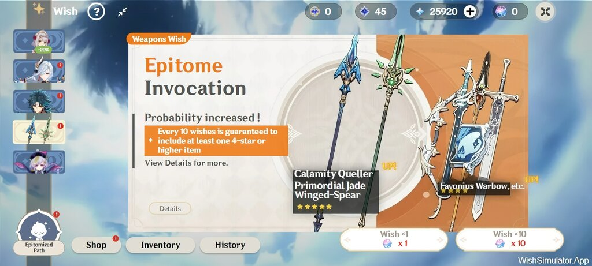
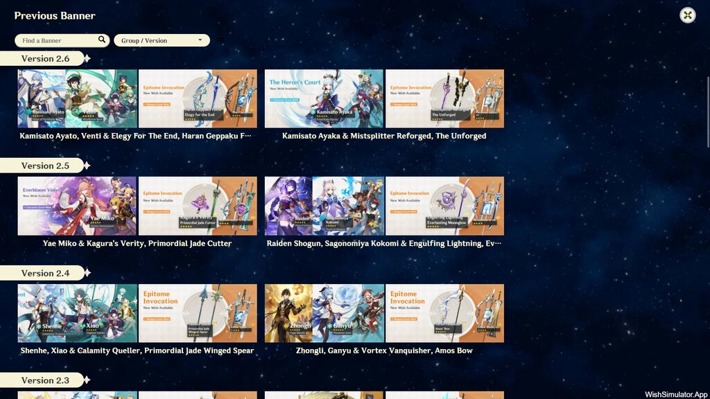
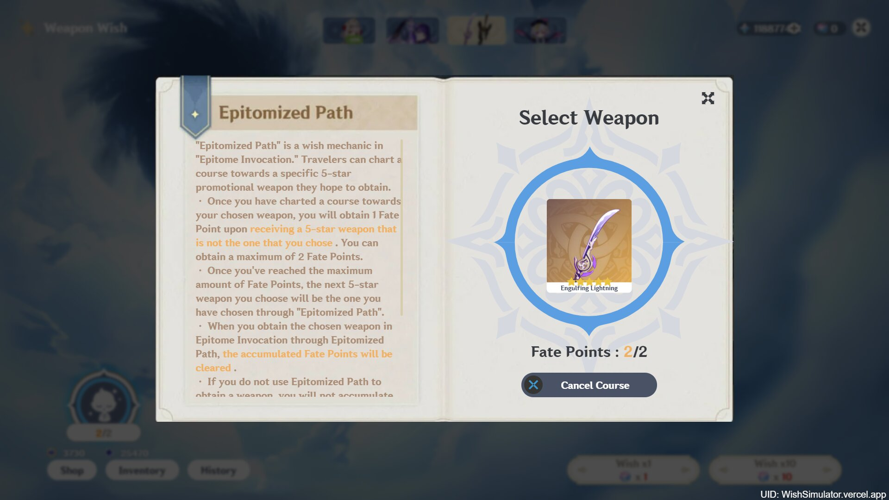
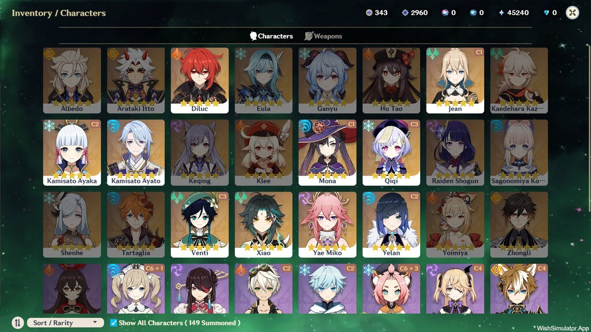

# 原神抽卡点名器 — 中文魔改版的原神祈愿模拟器，新增多名单点名功能

基于开源项目 [Genshin Impact Wish Simulator](https://github.com/Mantan21/Genshin-Impact-Wish-Simulator)（MIT 协议）二次开发。在还原游戏抽卡体验（保底、定轨、星辉星尘结算）的基础上，新增**名单点名**功能：把班级、团队或任意名单接入抽卡流程，用原神风格的抽卡动画随机点人，一轮内不重复。

**功能亮点**

- 名单点名：内置五星/四星角色与武器名单（带游戏内图标）；自己的名单（班级/团队等）可**导入 TXT（一人一行）**或批量粘贴，导入后还能逐条改名、增删、配图标
- 多名单混用：抽卡时勾选一套或多套名单，多选时合并为一个池子；洗牌算法保证一轮内每人只被点到一次
- 全中文界面：含上游此前未翻译的自定义卡池、卡池编辑器、备份恢复等模块
- 完全离线：已移除广告、赞赏、付费激活码、云端同步等依赖外部服务的功能，桌面版无需联网即可使用
- 完整抽卡模拟：新手/常驻/角色活动/武器活动/神铸赋形五类卡池，保底与神铸定轨机制与游戏一致

## 功能特性

### 名单点名（本版本新增）

1. 进入主界面后，在卡池列表中切换到最右侧的「点名祈愿」卡池
2. 点击卡面上的「名单管理」，勾选本次要点名用的名单（可多选，多选时合并成一个池子）
3. 预置名单共 6 套：五星角色、四星角色、全部角色、五星武器、四星武器、全部武器，均自带游戏内图标，随游戏数据自动同步，不可增删改
4. **导入自己的名单**（班级、团队、宿舍等真实姓名名单）：
   - 「导入 TXT」：选择文本文件，**一人一行**，自动去空行与首尾空格；支持 UTF-8 与 GBK 编码（Windows 记事本存的 ANSI 也能读）
   - 或在输入框里直接粘贴多行名字，点「批量添加」
   - 导入后可逐条重命名、删除、为单个成员导入图标（上限 2MB）
5. 抽卡即点名：单抽或十连，结果按原神抽卡动画展示；洗牌池保证一轮内不重复点到同一人，点完一轮自动重洗
6. 卡面与名单管理页都会显示「本轮已点 x / 共 y 人」，可随时重置本轮进度
7. 点名记录会写入「历史记录」页，可按「点名祈愿」单独筛选

> 隐私说明：你的名单只存在**浏览器本地存储**里，不联网、不上传。本版本刻意不内置任何真实姓名名单，也不会在代码仓库或安装包中携带用户数据。

### 抽卡模拟（继承自上游）

1. 五类卡池：初行者推荐、常驻、角色活动、武器活动、神铸赋形
2. 保底机制：90 抽必出五星、10 抽必出四星，概率随垫抽数提升，与游戏一致
3. 神铸定轨：武器池与神铸赋形池支持定轨，命定值累积满后必得定轨物品
4. 库存与历史：已获得的物品进库存，全部祈愿记录进历史，可导出备份
5. 自定义卡池：可自建卡池并调整概率、上传立绘（本版本移除了在线分享，仅本地使用）

## 截图

| 主界面 | 移动端布局 |
|---|---|
|  |  |

| 神铸定轨 | 库存 |
|---|---|
|  |  |

## 下载与安装

| 平台 | 文件 | 安装方式 |
|---|---|---|
| Windows | `genshin-wish-roll-<版本>-windows-x64-setup.exe` | 双击安装，可选安装目录，带开始菜单快捷方式与卸载项 |
| Windows | `genshin-wish-roll-<版本>-windows-x64-portable.zip` | 解压即用，无需安装，适合 U 盘携带 |
| 任意平台 | `genshin-wish-roll-<版本>-web.zip` | 解压后部署到任意静态服务器，或直接本地打开 |

系统要求：Windows 10 及以上（64 位）。桌面版数据保存在用户目录，卸载不影响；Web 版数据保存在浏览器本地存储。

具体下载地址见本仓库的 Release 页面。

## 使用说明

1. 首次启动会显示欢迎弹窗与更新公告，点「确认」进入主界面
2. 底部按钮：商城（星辉兑换）、仓库（已获物品）、历史记录（祈愿与点名记录）
3. 右上角齿轮进入菜单：设置、更新历史、自定义卡池、名单点名、备份与恢复
4. 名单点名：菜单 → 名单点名，勾选名单后即可在「点名祈愿」卡池抽人
5. 快捷键：`Enter` 十连、`Esc` 关闭弹窗、`M` 打开菜单（继承自上游）

## 从源码构建

```bash
# 安装依赖（Node 18+）
npm install

# 本地开发
npm run dev

# 构建 Web 静态站到 dist/
npm run build

# 构建 Windows 桌面版（安装版 + 便携目录）到 release/
npm run dist:win
```

桌面版构建依赖 [electron-builder](https://www.electron.build/)，配置见 `electron-builder.yml`。云端构建走 GitHub Actions（`.github/workflows/build-artifacts.yml`），一次产出 Web zip、安装版 exe、便携版 zip 三种产物。

## 项目结构

| 目录 | 内容 |
|---|---|
| `src/routes/` | 页面与路由（SvelteKit） |
| `src/lib/helpers/gacha/` | 抽卡概率与保底算法 |
| `src/lib/helpers/rollcall/` | 名单点名：预置名单、抽取算法、图标解析、TXT 导入解析（本版本新增） |
| `src/lib/helpers/dataAPI/` | 本地存储封装：IndexedDB、localStorage、备份导入导出、名单存储（本版本新增 api-rollcall.js） |
| `src/lib/data/` | 游戏数据：角色、武器、卡池、版本配置（**不含任何真实姓名名单**） |
| `src/images/` | 角色立绘、卡面、武器图标等素材 |
| `src/locales/` | 多语言文案（zh-CN 已 100% 覆盖） |
| `src/post/` | 页面内嵌的中文说明文档（自定义卡池指南、安装说明、隐私政策） |
| `electron/` | Electron 主进程与预加载脚本（本版本新增） |
| `scripts/` | 校验脚本：语言包英文残留扫描、TXT 解析单测、隐私门禁（新增） |

## 常见问题

**点名会重复点到同一个人吗？**
不会。点名使用洗牌池：每轮开始时把名单打乱，逐个取出，取完一轮才重新洗牌。刷新页面或重启应用也不会重复，进度存在本地。

**可以只用自己建的名单吗？**
可以。在名单管理页把所有预置名单的勾选取消，只勾选你的自定义名单即可。也可以预置与自定义混勾。

**为什么不内置班级名单？**
名单里通常是真实姓名，属于个人信息。内置在代码仓库和安装包里等于把它公开分发，所以本版本刻意不内置任何真实姓名名单——由你自己导入 TXT，数据只留在本机。

**TXT 名单有什么格式要求？**
一人一行，不需要编号或分隔符。空行与首尾空格会自动忽略，同名的人可以重复出现（点名场景可能真有两个同名的人）。文件编码支持 UTF-8 与 GBK，Windows 记事本默认保存的 ANSI 编码也能正确读取。单个文件最多读 2000 行。

**为什么没有广告和赞赏入口？**
本版本已移除上游的广告、赞赏、付费激活码与全部依赖外部服务的功能（云端同步、评论区、图床上传），同时移除了原站点遗留的访问统计上报代码，因此可以完全离线使用。

**数据存在哪里？会上传吗？**
全部存在本机：Web 版在浏览器 LocalStorage 与 IndexedDB，桌面版在应用用户目录。本版本没有任何上传通道，应用启动后不发出网络请求。

**打开的一瞬间标题会不会是英文？**
不会。页面语言标记与标题写在静态 HTML 里，打开即中文，界面正文也由语言包在渲染前就绪，不存在「先英文再变中文」的过程。

## 许可证

本项目基于 [Genshin Impact Wish Simulator](https://github.com/Mantan21/Genshin-Impact-Wish-Simulator) 二次开发，沿用其 MIT 许可证，原版权声明见 `LICENSE`。

游戏内角色立绘、卡面、图标、音效等素材版权归 miHoYo / HoYoverse 所有，本项目为粉丝自制的非商业模拟工具，与 miHoYo / HoYoverse 无任何关联。
