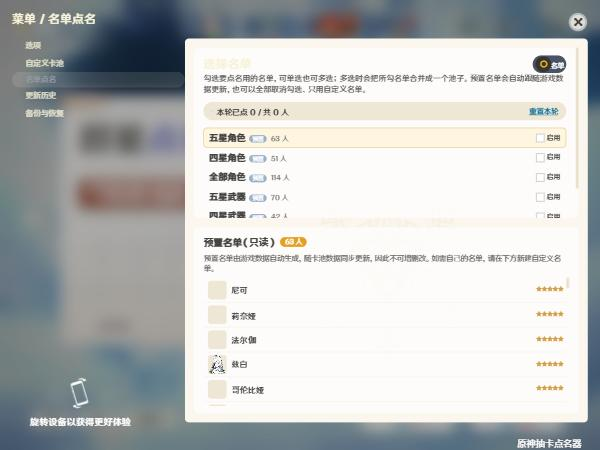

# 原神抽卡点名器 — 中文修改版的原神祈愿模拟器，新增多名单点名功能

基于开源项目 [Genshin Impact Wish Simulator](https://github.com/Mantan21/Genshin-Impact-Wish-Simulator)（MIT 协议）二次开发：还原游戏抽卡体验（保底、定轨、星辉星尘结算），并新增**名单点名**——把班级、团队或任意名单接入抽卡流程，用原神风格的抽卡动画随机点人，一轮内不重复。

**亮点**

- 名单点名：自建名单（添加 / 批量添加 / 导入 TXT），可指定星级与头像；多名单勾选混用，洗牌保证一轮不重复
- 完全离线：无广告、无赞赏、无激活码、无统计上报，不发出任何网络请求
- 全中文界面，打开即中文
- 三端产物：Windows 安装版 / 便携版 / 安卓 APK

## 功能特性

**名单点名（本版本新增）**

1. 主界面切到「群星点名」卡池页签；齿轮 → 群星点名 管理名单
2. 建名单三种方式：单条添加（名字 + 星级 + 图像）、批量添加（多行粘贴）、导入 TXT（一人一行，行尾加空格和数字可指定星级，如 `张三 5`）
3. 勾选启用后抽卡即点名；单抽十连都走原神抽卡动画，姓名竖排毛笔字展示
4. 卡面显示「本轮已点 x / 共 y 人」，可重置；点名记录进历史页可筛选

> 隐私说明：名单只存本机，不联网不上传。本版本不内置任何真实姓名名单。

**抽卡模拟（继承自上游）**

- 五类卡池：初行者推荐、常驻、角色活动、武器活动、神铸赋形
- 保底与定轨：90 抽必出五星、10 抽必出四星；武器池神铸定轨与游戏一致
- 库存、历史、备份导出；自定义卡池（本地使用，无在线分享）

## 截图

| 主界面（中文） | 点名祈愿卡池 |
|---|---|
|  |  |

| 名单管理 | 点名结果 |
|---|---|
|  |  |

## 下载与安装

| 平台 | 文件 | 安装方式 |
|---|---|---|
| Windows | `genshin-wish-roll-richkobe-<版本>-windows-x64-setup.exe` | 双击安装；未签名，SmartScreen 拦截时点「更多信息 → 仍要运行」 |
| Windows | `genshin-wish-roll-richkobe-<版本>-windows-x64-portable.zip` | 解压后双击 exe 即用 |
| Android | `genshin-wish-roll-richkobe-<版本>-android-arm64.apk` | 允许未知来源后安装；包名 `com.richkobe.giws`，固定横屏 |

下载地址见本仓库 [Release 页面](https://github.com/yibanm/Genshin-Impact-Wish-Simulator-richkobe/releases)。系统要求：Windows 10+（64 位）/ 安卓 7.0+。覆盖安装保留数据。

## 使用说明

1. 开屏弹窗含更新公告与「使用教程」入口；勾「不再提示」后下次不弹
2. 底部：商城、仓库（左上角可搜索全部角色）、历史
3. 齿轮进菜单：设置、自定义卡池、群星点名、备份与恢复、关于
4. 快捷键：`Enter` 十连、`Esc` 关闭弹窗、`M` 打开菜单

## 从源码构建

```bash
npm install
npm run dev          # 本地开发
npm run build        # Web 静态站到 dist/
npm run tauri:build  # Windows 桌面版（Tauri，需 Rust 工具链）
```

安卓壳为 Capacitor：`npm run build && npx cap sync android` 后用 Gradle 打包。云端构建走 GitHub Actions（`.github/workflows/build-artifacts.yml`）。

## 常见问题

**点名会重复点到同一个人吗？**
不会。洗牌池逐轮抽取，取完才重洗；进度存本地，刷新或重启不重复。

**TXT 名单格式？**
一人一行，空行与首尾空格自动忽略，同名可重复。编码支持 UTF-8 与 GBK（记事本 ANSI 也能读），单文件上限 2000 行。行尾「空格 + 3/4/5」指定星级。

**数据存在哪里？会上传吗？**
全在本机（浏览器 LocalStorage/IndexedDB 或应用用户目录），无任何上传通道。

**为什么没有广告和赞赏？**
本版本移除了上游的广告、赞赏、激活码与全部外部服务依赖，以及原站点遗留的统计上报代码。

## 许可证

基于 [Genshin Impact Wish Simulator](https://github.com/Mantan21/Genshin-Impact-Wish-Simulator) 二次开发，沿用 MIT 许可证，原版权声明见 `LICENSE`。点名结果展示使用的毛笔字体为马善政楷书（OFL-1.1）。

游戏内角色立绘、卡面、图标、音效等素材版权归 miHoYo / HoYoverse 所有，本项目为粉丝自制的非商业模拟工具，与 miHoYo / HoYoverse 无任何关联。
